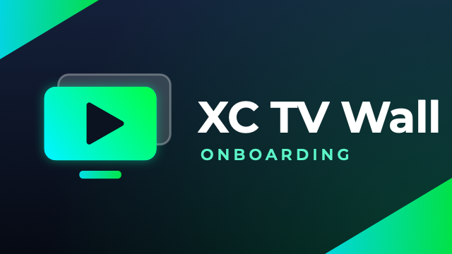

# XC TV Wall

**Turn any Fire TV Stick into a digital sign that plays a Google Drive folder.**

Drop pictures, Google Slides, PDFs and videos into a Drive folder. Every TV running XC TV Wall
picks them up within minutes and loops them full screen. You don't need a subscription, a
signage service or a server, and the folder never has to be public.

Use it for whatever your screens should show: office announcements, onboarding and welcome
messages, team dashboards exported as slides, a reception or lobby screen, event schedules,
a menu board, a shop window…

<p align="center"></p>

## Features

- **Google Drive as the CMS.** Anyone who can edit the folder can change what's on screen, from
  a laptop or a phone.
- **Private by design.** The app reads the folder with its own Google service account. Share the
  folder with that account as *Viewer*; nothing gets a public link.
- **Plays offline.** Every TV keeps a local copy and keeps looping it if the Wi-Fi or Google
  goes away.
- **Mixed media.** Images, Google Slides decks, PDFs, and videos with sound.
- **No glitches mid-show.** Changes are downloaded in the background. The new playlist is swapped
  in only once the download has fully succeeded, and starts at the next loop.
- **Hands-off.** It starts when the TV boots, keeps the screen awake, and ignores the Back button
  so nobody stops it by accident.
- **Adjustable pace.** Pick 3–60 seconds per picture or slide from the remote. Videos always play
  to the end.
- **Self-updating.** Put a newer APK in the folder and each TV offers to install it.

## How it works

```
 Google Drive folder              Fire TV Stick running XC TV Wall
 ┌──────────────────┐   every    ┌───────────────────────────────────────────────┐
 │ 01_welcome.png   │  5 min     │ sync: list → download changes → swap playlist │
 │ 02_q4-goals      │ ─────────▶ │ local cache (survives reboots, no Wi-Fi)      │
 │ 03_demo.mp4      │ service    │ player: images · Slides/PDF pages · video     │
 │ _app/  (updates) │ account    └───────────────────────────────────────────────┘
 └──────────────────┘
```

`PlayerActivity` loops a `PlaylistQueue` built from the last good sync. Every 5 minutes
`SyncEngine` lists the folder through `ServiceAccountDriveSource` and downloads what changed into
a staging area. It swaps in the new playlist only if every download succeeded. Google Slides are
exported to PDF, and PDF pages are drawn with Android's `PdfRenderer`. Videos play through
Media3 ExoPlayer. The original design notes are in
[`docs/design.md`](docs/design.md).

## Requirements

| | |
|---|---|
| Player | Amazon Fire TV Stick 4K / 4K Max (tested on Fire OS 7). Other Android TV devices with Android 7.1+ should work but haven't been tested. |
| Content | A Google Drive folder (My Drive or a Shared Drive) |
| Google Cloud | A free project with the Drive API enabled and one service account |
| To build | JDK 17 and the Android SDK; macOS, Linux or Windows |

---

## Using it: managing what's on screen

This is the part to share with whoever edits the content.

| Want to… | Do this |
|---|---|
| Add something | Drop it in the folder. TVs pick it up within about 5 minutes. |
| Remove something | Delete it from the folder. |
| Set the order | Start names with numbers: `01_intro.png`, `02_news.mp4`, … (`2_` plays before `10_`). Otherwise files play in name order. |
| Hide something without deleting it | Start its name with `_` (e.g. `_draft.png`). |
| Show one picture or deck longer | Add `__20s` at the end of the name: `03_welcome__20s.png`, `04_deck__15s`. |
| Change how fast everything moves | On the TV, press **OK** (or **☰**) on the remote, then **◀ ▶** to pick 3–60 seconds, then **OK** or **Back** to close. This is saved on that TV and applies from the next slide. |

**What plays**

| Type | Formats | Time on screen |
|---|---|---|
| Images | JPG, PNG, WebP | The TV's slide speed (10 s out of the box) |
| Google Slides | Native Slides files | Each slide for the slide speed. Animations and transitions aren't shown. |
| PDF | `.pdf` | Each page for the slide speed |
| Video | MP4, MOV, WebM | Always to the end, with sound |

- A `__20s` suffix beats the TV's slide speed for that file.
- **PowerPoint (.pptx) is not played.** Open it in Drive, use *File → Save as Google Slides*,
  then hide the original by renaming it `_name.pptx`.
- Subfolders, Drive shortcuts, Docs, Word files, GIFs and HEIC photos are ignored.

If one file can't be fetched, everything else still updates. That file keeps its previous version
(or is left out) and is retried every 5 minutes. Common causes:

- a large Google Slides deck that Google refuses to export (over about 10 MB). Use
  *File → Download → PDF* and put the PDF in the folder instead;
- a file whose owner turned off downloading for viewers. Turn it back on in the share settings.

---

## Setup

Each build is tied to one Drive folder and one service account. Both are baked into the APK at
build time.

### 1. Google Cloud (about 10 minutes, free)

1. In the [Google Cloud console](https://console.cloud.google.com/), create a project
   (e.g. `tv-wall`).
2. **APIs & Services → Library** → enable the **Google Drive API**.
3. **IAM & Admin → Service Accounts → Create service account** (e.g. `tv-wall`). It needs no roles.
4. Open it → **Keys → Add key → Create new key → JSON**. Save the file as
   `secrets/service-account.json` in this repo.
   > If your Google Workspace blocks key creation (policy `iam.disableServiceAccountKeyCreation`),
   > an admin has to allow it for this project.
5. Copy the service account's email (`tv-wall@<project>.iam.gserviceaccount.com`).
6. In Google Drive, **Share** the content folder with that email as **Viewer**. For a folder in a
   Shared Drive, add the email to the Shared Drive as a Viewer.
7. Open the folder in a browser. The folder id is the last part of the URL
   (`https://drive.google.com/drive/folders/<FOLDER_ID>`). Create `secrets/config.properties`:
   ```properties
   driveFolderId=<FOLDER_ID>
   ```

### 2. Signing key (once)

Android only installs an update if it's signed with the same key as the installed app. Create
the key once and **back it up**, for example in a password manager:

```bash
keytool -genkeypair -v -keystore secrets/release.keystore -alias tv-wall \
  -keyalg RSA -keysize 2048 -validity 10000
```

Then create `secrets/keystore.properties`:

```properties
storeFile=release.keystore
storePassword=<your password>
keyAlias=tv-wall
keyPassword=<your password>
```

Everything in `secrets/` except its `README.txt` is git-ignored.

### 3. Build

Point `local.properties` at your Android SDK (`sdk.dir=...`), then:

```bash
./gradlew test               # unit tests
./gradlew assembleRelease    # → app/build/outputs/apk/release/app-release.apk
```

If you're publishing your own build, change `applicationId` in `app/build.gradle.kts` to a name
you own.

To check that the key and the folder sharing work before you install anything, run:

```bash
TVWALL_SA_JSON=$PWD/secrets/service-account.json TVWALL_FOLDER_ID=<FOLDER_ID> \
  ./gradlew testDebugUnitTest --tests '*DriveSmokeTest' -i | grep "Drive folder has"
```

### 4. Install on each Fire TV Stick

On the TV:

1. **Settings → My Fire TV → About** → click the device name (e.g. *Fire TV Stick 4K*) **7 times**
   until it says you're a developer.
2. **Settings → My Fire TV → Developer options** → turn on **ADB debugging**.
3. **Settings → My Fire TV → About → Network** → note the **IP address**.

From a computer on the same network (`adb` ships in the Android SDK's `platform-tools/`):

```bash
adb connect <TV-IP>:5555            # accept the prompt on the TV the first time
adb install -r app/build/outputs/apk/release/app-release.apk
# Let the app start itself when the TV boots. Both lines are needed:
adb shell appops set tech.xelerate.tvwall.player SYSTEM_ALERT_WINDOW allow
adb shell appops write-settings
adb shell am start -n tech.xelerate.tvwall.player/tech.xelerate.tvwall.ui.PlayerActivity
```

(Replace `tech.xelerate.tvwall.player` if you changed `applicationId`.)

Then, on the TV, allow the app to install its own updates:
**Settings → My Fire TV → Developer options → Install unknown apps → XC TV Wall → On**.

Tip: turn on **HDMI-CEC** in the TV's settings so the TV and the stick wake up together.

### 5. Shipping updates

1. Increase `versionCode` (and `versionName`) in `app/build.gradle.kts`.
2. `./gradlew assembleRelease`
3. Upload the APK to an `_app/` subfolder of the content folder, named
   `xc-tv-wall-<versionCode>.apk` (e.g. `xc-tv-wall-3.apk`).
4. Within an hour each TV shows the Android installer. Press **Install** with the remote; the
   slideshow comes back by itself.

## Security

- **Your APK contains your service-account key.** Treat it like a password: install it with
  `adb`, and don't post it on a public link or in a release. Anyone with the APK can read
  whatever is shared with that service account, and nothing else.
- Give the service account no project roles, and share only the folders the TVs should show.
- If an APK leaks, delete the key in the Cloud console and build a new APK with a fresh key.
- Never commit anything from `secrets/`.

## Troubleshooting

| On screen | Meaning / fix |
|---|---|
| *Not configured — see README* | The APK was built without `secrets/service-account.json` or `secrets/config.properties`. Add them and rebuild. |
| *Waiting for content…* that never goes away | The folder is empty, isn't shared with the service-account email, or the folder id is wrong. It can also mean the TV had no internet on its first run. Run the smoke test in [Build](#3-build). |
| The app doesn't start after a reboot | Re-run the two `appops` lines in [Install](#4-install-on-each-fire-tv-stick). |
| A file is skipped | It's an unsupported type or a corrupt file. Check `adb logcat -s XcTvWall`. |
| Old icon on the Fire TV home screen | Fire TV keeps the first tile it saw for an app id, even after an uninstall. See [App icon](#app-icon). |

The Back button only closes the slide-speed menu. Press **Home** to leave the app.

## Development

```
app/src/main/java/tech/xelerate/tvwall/
├── core/       playlist rules, sync engine, playlist queue, update check (plain Kotlin, unit-tested)
├── drive/      Google Drive access through a service account
├── ui/         full-screen player: images, PDF/Slides pages, video, slide-speed menu
├── settings/   per-TV preferences
├── boot/       start on boot / after an update
└── update/     self-update installer
```

- Kotlin, Gradle 8.9, AGP 8.5, minSdk 25, targetSdk 34, Media3 ExoPlayer, Google Drive API v3.
- `./gradlew test` runs the unit suite. The Drive logic is tested against `FakeDriveSource`, so
  the tests don't need network or credentials. `DriveSmokeTest` runs only when the `TVWALL_*`
  variables are set.
- Fire OS hides debug logs. To see them, run `adb shell setprop log.tag.XcTvWall VERBOSE`.

### App icon

`tools/render-icons.swift` draws the icon and banner. It needs macOS and the free
[Montserrat](https://fonts.google.com/specimen/Montserrat) font:
`swift tools/render-icons.swift app/src/main/res`.

- For sideloaded apps, Fire TV ignores the banner and adaptive icons. It centres the square
  `drawable-*/ic_tile.png` on its own grey 16:9 tile. The icon has a transparent background, so
  the grey runs through and the tile reads as one wide picture.
- `drawable-*/banner.png` is used by Android TV and Google TV launchers.
- Fire TV keeps the tile picture it first saw for an app id, so an icon change won't show on
  sticks that already had the app. Change `applicationId` to force a new tile.

## Contributing

Issues and pull requests are welcome. Please:

- keep `core/` free of Android dependencies, and add a unit test for any behaviour change;
- run `./gradlew test` before opening a PR;
- never include keys, folder ids or APKs built with real credentials.

## License

[MIT](LICENSE) © 2026 Xelerate

Made by [Xelerate](https://xelerate.tech).
